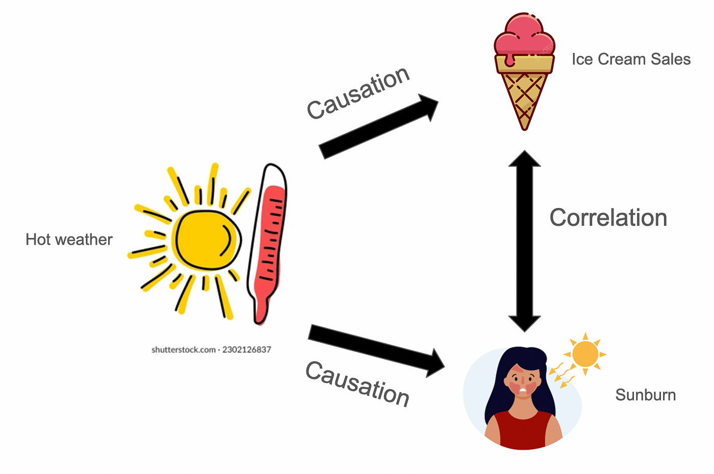

```{r}
#| label: setup
library(tidyverse)
library(dagitty)
library(ggdag)
library(patchwork)
knitr::opts_chunk$set(dev = "ragg_png")

# ---- Design tokens (same values as custom.scss) ----
ink    <- "#0F1115"; ink2  <- "#3D4350"; muted <- "#6B7280"; faint <- "#A3A9B4"
rule   <- "#E3E6EA"; panel <- "#F5F6F8"
accent <- "#C2410C"; accent_tint <- "#FFF4ED"; accent_soft <- "#F2B48F"
treat_col <- accent     # treated / Y(1)
ctrl_col  <- "#5B6270"  # control / Y(0)

theme_ci <- function(base_size = 20) {
  theme_minimal(base_size = base_size, base_family = "Inter") +
    theme(
      text = element_text(colour = ink2),
      plot.title = element_text(family = "Inter SemiBold", colour = ink, size = rel(0.95),
                                hjust = 0, margin = margin(b = 10)),
      plot.title.position = "plot",
      plot.subtitle = element_text(colour = muted, size = rel(0.8)),
      plot.caption = element_text(colour = muted, size = rel(0.7), hjust = 0),
      axis.title = element_text(colour = muted, size = rel(0.8)),
      axis.text = element_text(colour = muted, size = rel(0.75)),
      panel.grid.minor = element_blank(),
      panel.grid.major = element_line(colour = rule, linewidth = 0.4),
      strip.text = element_text(family = "Inter SemiBold", colour = ink, size = rel(0.9), hjust = 0),
      legend.title = element_blank(),
      legend.text = element_text(colour = ink2, size = rel(0.8)),
      plot.background = element_rect(fill = "white", colour = NA),
      plot.margin = margin(10, 14, 10, 10)
    )
}
theme_set(theme_ci())
update_geom_defaults("text",  list(family = "Inter", colour = ink2))
update_geom_defaults("label", list(family = "Inter", colour = ink2))

# ---- DAGs: rounded labels coloured by role; arrows stop at the label edge ----
dag_roles <- tribble(
  ~role,         ~fill,   ~col,    ~lw, ~lt,
  "treatment",   accent,  "white", 0,   "solid",
  "outcome",     ink,     "white", 0,   "solid",
  "other",       "white", ink,     0.6, "solid",
  "unobserved",  "white", muted,   0.6, "dashed",
  "conditioned", panel,   ink,     1.6, "solid"
)
dag_plot <- function(d, roles = list(), size = 7, xpad = 0.5, ypad = 0.3) {
  td <- tidy_dagitty(d)$data
  td$role <- "other"
  for (r in names(roles)) td$role[td$name %in% roles[[r]]] <- r
  nodes <- distinct(td, name, x, y, role)
  edges <- filter(td, !is.na(to)) %>%
    mutate(lt = ifelse(name %in% roles$unobserved, "dashed", "solid"))
  fs  <- size * .pt
  pad <- margin(12, 16, 12, 16)
  v <- function(col) setNames(dag_roles[[col]], dag_roles$role)
  ggplot(edges, aes(x = x, y = y, xend = xend, yend = yend)) +
    geom_dag_edges_link(
      aes(start_cap = ggraph::label_rect(name, fontsize = fs, padding = pad),
          end_cap   = ggraph::label_rect(to,   fontsize = fs, padding = pad),
          edge_linetype = lt),
      edge_colour = muted, edge_width = 0.9,
      arrow = grid::arrow(length = grid::unit(11, "pt"), type = "closed")) +
    ggraph::scale_edge_linetype_identity() +
    geom_label(data = nodes, aes(x, y, label = name, fill = role, colour = role,
                                 linewidth = role, linetype = role),
               inherit.aes = FALSE, family = "Inter", size = size,
               label.padding = unit(0.45, "lines"), label.r = unit(0.55, "lines")) +
    scale_fill_manual(values = v("fill"), guide = "none") +
    scale_colour_manual(values = v("col"), guide = "none") +
    scale_linewidth_manual(values = v("lw"), guide = "none") +
    scale_linetype_manual(values = v("lt"), guide = "none") +
    scale_x_continuous(expand = expansion(add = xpad)) +
    scale_y_continuous(expand = expansion(add = ypad)) +
    coord_cartesian(clip = "off") +
    theme_void(base_family = "Inter") +
    theme(plot.background = element_rect(fill = "white", colour = NA),
          plot.title = element_text(family = "Inter SemiBold", colour = ink, size = 22,
                                    hjust = 0.5, margin = margin(b = 8)),
          plot.caption = element_text(colour = ink2, size = 17, hjust = 0.5,
                                      lineheight = 1.15, margin = margin(t = 10)))
}
```


# Schedule {.schedule}

| Time | Block |
|---|---|
| 10:00–10:50 | **1. Foundations:** potential outcomes and the fundamental problem |
| 10:50–11:00 | *Break* |
| 11:00–11:30 | **2a. Experiments:** why randomization works |
| 11:30–12:00 | **2b. Lab 1:** simulating potential outcomes and randomization |
| 12:00–13:00 | *Lunch* |
| 13:00–13:50 | **3a. Observational studies:** DAGs and designs that mimic experiments |
| 13:50–14:20 | **3b. Lab 2:** difference-in-differences |
| 14:20–14:30 | *Break* |
| 14:30–15:00 | **4. Advanced topics** and wrap-up |

Core text: Huntington-Klein, [*The Effect*](https://theeffectbook.net) (free online)


# My Background & Research Interests


# Today's goals

By the end of today you should be able to:

::: {.incremental}
1. Turn a research question into a **causal question** with a clear counterfactual
2. Explain the **fundamental problem of causal inference** and **selection bias**
3. Explain **why randomization works**, and what can go wrong in experiments
4. Use **DAGs** to state your assumptions
5. Explain the key assumption behind **DiD, RD and IV**, and run a simple DiD
:::

::: {.notes}
Emphasise: this is about *design*, not statistics. Very little maths today.
:::


# Part 1: Foundations {.section-slide background-color="#0F1115"}

Potential outcomes, counterfactuals and the fundamental problem

::: {.notes}
~50 minutes. Reading: The Effect Ch. 1, 5, 10; Mixtape Ch. 4.
:::


# Correlation vs. Causation

{fig-align="center" height="650" fig-alt="Correlation vs causation"}


# What makes a question *causal*?

::: {.incremental}
- **Descriptive:** How many people voted in the 2024 UK general election?
- **Predictive:** Which constituencies are likely to swing at the next election?
- **Causal:** Does receiving a canvassing visit *make* people more likely to vote?

- Causal questions are about **interventions**: what would happen if we *changed* something?
- Most of the questions social scientists care about are causal, even when we don't say so ("the effect of", "leads to", "increases", "explains")
:::


# Counterfactual Thinking

:::: {.columns .middle}
::: {.column width="56%"}
::: {.incremental}
- A causal effect is a comparison between **two states of the world**:
  - the world where the treatment happened, and
  - the world where it **didn't**: the **counterfactual**
- **Example:**
  - Maya takes part in a civic education programme, and then votes in every election.
  - **Counterfactual:** Would Maya have voted anyway, *without* the programme?
- The causal effect is the difference between those two worlds, *for the same person at the same time*.
:::
:::
::: {.column width="44%"}
```{r}
#| label: two-worlds
#| fig-width: 6.2
#| fig-height: 5.4
#| fig-alt: "Two states of the world for Maya: with the programme (observed) and without it (the counterfactual, never observed)"
box <- function(x, y, label, fill, col, lt = "solid", lw = 0, fam = "Inter")
  annotate("label", x = x, y = y, label = label, fill = fill, colour = col, linetype = lt,
           linewidth = lw, size = 6.4, family = fam, lineheight = 1.05,
           label.padding = unit(0.65, "lines"), label.r = unit(0.6, "lines"))
arrow_seg <- function(y, yend, col, lt = "solid")
  annotate("segment", x = 0.62, xend = 1.33, y = y, yend = yend, colour = col, linetype = lt,
           linewidth = 1.1, arrow = grid::arrow(length = unit(11, "pt"), type = "closed"))
ggplot() +
  arrow_seg(0.12, 0.92, accent) +
  arrow_seg(-0.12, -0.92, faint, "22") +
  box(0.25, 0, "Maya", ink, "white", fam = "Inter SemiBold") +
  annotate("text", x = 2.35, y = 1.66, label = "WORLD 1  ·  OBSERVED",
           colour = accent, size = 4.8, family = "Inter SemiBold") +
  box(2.35, 1.05, "Takes the programme\n↓\nVotes in every election", accent_tint, ink) +
  annotate("text", x = 2.35, y = -0.42, label = "WORLD 2  ·  COUNTERFACTUAL",
           colour = muted, size = 4.8, family = "Inter SemiBold") +
  box(2.35, -1.05, "No programme\n↓\nWould she have voted?", "white", muted, lt = "22", lw = 0.7) +
  annotate("text", x = 2.35, y = -1.8, label = "never observed",
           colour = muted, size = 5.2, family = "Inter", fontface = "italic") +
  scale_x_continuous(limits = c(-0.05, 3.3)) +
  scale_y_continuous(limits = c(-1.95, 1.82)) +
  theme_void()
```
:::
::::


# The Potential Outcomes Framework

::: {.incremental}
- **Treatment** $D_i$ for unit $i$:
  - $D_i = 1$: treated
  - $D_i = 0$: not treated (control)
- **Potential outcomes**, defined *before* treatment is assigned:
  - $Y_i(1)$: the outcome unit $i$ *would* have if treated
  - $Y_i(0)$: the outcome unit $i$ *would* have if not treated
- **Individual treatment effect:**
:::

::: {.fragment}
$$\tau_i = Y_i(1) - Y_i(0)$$
:::


# A world where we can see everything {.smaller}

Does a civic education programme increase political participation (0–100 score)?

:::: {.columns .middle}
::: {.column .po width="46%"}
| Unit | Prior interest | $Y_i(0)$ | $Y_i(1)$ | $\tau_i$ |
|:----:|:--------------:|:--------:|:--------:|:--------:|
| 1 | High | 60 | 65 | 5 |
| 2 | High | 70 | 72 | 2 |
| 3 | High | 55 | 63 | 8 |
| 4 | Low  | 40 | 46 | 6 |
| 5 | Low  | 35 | 39 | 4 |
| 6 | Low  | 30 | 35 | 5 |
:::
::: {.column width="54%"}
```{r}
#| label: po-dumbbell
#| fig-width: 7.2
#| fig-height: 4.3
#| fig-alt: "Both potential outcomes for each of the six units, with the individual effect"
po <- tibble(unit = 1:6, y0 = c(60, 70, 55, 40, 35, 30), y1 = c(65, 72, 63, 46, 39, 35)) %>%
  mutate(lab = fct_rev(fct_inorder(paste("Unit", unit))))
ggplot(po, aes(y = lab)) +
  geom_segment(aes(x = y0, xend = y1, yend = lab), colour = rule, linewidth = 2.6) +
  geom_point(aes(x = y0, colour = "Y(0): without programme"), size = 5.5) +
  geom_point(aes(x = y1, colour = "Y(1): with programme"), size = 5.5) +
  geom_text(aes(x = y1 + 2.2, label = paste0("τ = ", y1 - y0)), hjust = 0, size = 5.8) +
  scale_colour_manual(values = c("Y(0): without programme" = ctrl_col,
                                 "Y(1): with programme" = treat_col)) +
  scale_x_continuous("Participation score", limits = c(25, 82), breaks = seq(30, 80, 10)) +
  labs(y = NULL) +
  theme(legend.position = "top", legend.justification = "left",
        legend.margin = margin(0, 0, 0, -50), panel.grid.major.y = element_blank())
```
:::
::::

::: {.fragment}
- Effects differ from person to person (**heterogeneity**)
- The **average treatment effect**: $ATE = E[Y_i(1) - Y_i(0)] = \frac{5+2+8+6+4+5}{6} = 5$
:::


# The Fundamental Problem of Causal Inference

::: {.incremental}
- Each unit is either treated **or** not, never both.
- So we only ever observe **one** potential outcome per unit:

$$Y_i = D_i \cdot Y_i(1) + (1 - D_i) \cdot Y_i(0)$$

- The other potential outcome is the **counterfactual**, and it is **missing**.
- Causal inference is a **missing data problem**.
:::


# What we actually see {.smaller}

Suppose people **choose** whether to take the programme, and the politically interested sign up:

:::: {.columns .middle}
::: {.column .po width="50%"}
| Unit | Prior interest | $D_i$ | $Y_i(0)$ | $Y_i(1)$ | $\tau_i$ |
|:----:|:--------------:|:-----:|:--------:|:--------:|:--------:|
| 1 | High | 1 | **?** | 65 | **?** |
| 2 | High | 1 | **?** | 72 | **?** |
| 3 | High | 1 | **?** | 63 | **?** |
| 4 | Low  | 0 | 40 | **?** | **?** |
| 5 | Low  | 0 | 35 | **?** | **?** |
| 6 | Low  | 0 | 30 | **?** | **?** |
:::
::: {.column .fragment fragment-index=1 width="50%"}
```{r}
#| label: naive-comparison
#| fig-width: 6.8
#| fig-height: 3.9
#| fig-alt: "Observed outcomes of the treated and control groups and the naive difference in means"
ob <- tibble(group = rep(c("Treated\n(high interest)", "Control\n(low interest)"), each = 3),
             y = c(65, 72, 63, 40, 35, 30)) %>%
  mutate(group = fct_inorder(group))
mns <- ob %>% group_by(group) %>% summarise(m = mean(y))
ggplot(ob, aes(y, fct_rev(group), colour = group)) +
  geom_point(size = 6, alpha = 0.9) +
  geom_point(data = mns, aes(m, fct_rev(group)), shape = "|", size = 15) +
  geom_text(data = mns, aes(m, as.numeric(fct_rev(group)) + c(0.33, -0.33),
                            label = paste0("mean ", round(m, 1))),
            size = 5.6, family = "Inter SemiBold") +
  annotate("segment", x = 35.4, xend = 66.3, y = 1.5, yend = 1.5, colour = ink, linewidth = 0.8,
           arrow = grid::arrow(length = unit(7, "pt"), ends = "both", type = "closed")) +
  annotate("text", x = 50.85, y = 1.62, label = "naive difference = 31.7", size = 5.6, colour = ink,
           family = "Inter SemiBold") +
  scale_colour_manual(values = c(treat_col, ctrl_col), guide = "none") +
  scale_x_continuous("Observed participation score", limits = c(25, 80), breaks = seq(30, 80, 10)) +
  labs(y = NULL) +
  theme(panel.grid.major.y = element_blank(),
        axis.text.y = element_text(colour = ink2, size = 16, hjust = 1, lineheight = 0.95))
```
:::
::::

::: {.fragment fragment-index=1}
- We **cannot** compute any individual effect.
- We **can** compare averages: treated mean $= 66.7$, control mean $= 35$.
- Naive difference $= 31.7$. But the true ATE is $5$!
:::


# What are we trying to estimate?

Before estimating anything, be clear about the **estimand**: the causal quantity you want.

::: {.incremental}
- **ATE** (average treatment effect): the average effect for **everyone**
  - $ATE = E[Y_i(1) - Y_i(0)]$
- **ATT** (average treatment effect on the treated): the average effect for **those who got treated**
  - $ATT = E[Y_i(1) - Y_i(0) \mid D_i = 1]$
- **ATU** (average treatment effect on the untreated): the average effect for **those who didn't**
  - $ATU = E[Y_i(1) - Y_i(0) \mid D_i = 0]$
- In our example: $ATT = \frac{5+2+8}{3} = 5$, $ATU = \frac{6+4+5}{3} = 5$. Here they coincide, but in general they **differ** (e.g. if those who benefit most are the ones who sign up)
:::


# Why the naive comparison fails

The naive difference in means can be split into two parts:

$$
\underbrace{E[Y_i \mid D_i{=}1] - E[Y_i \mid D_i{=}0]}_{\text{naive difference}}
= \underbrace{E[Y_i(1) - Y_i(0) \mid D_i{=}1]}_{\text{ATT}}
+ \underbrace{E[Y_i(0) \mid D_i{=}1] - E[Y_i(0) \mid D_i{=}0]}_{\text{selection bias}}
$$

::: {.fragment}
In our example:

$$\underbrace{31.7}_{\text{naive}} = \underbrace{5}_{\text{ATT}} + \underbrace{(61.7 - 35)}_{\text{selection bias} \; = \; 26.7}$$
:::

::: {.fragment .keybox}
**Selection bias:** the treated group would have had different outcomes **even without treatment**. Interested people participate more, programme or not.
:::


# How can we approximate the counterfactual?

::: {.incremental}
- We need a comparison group whose outcomes tell us what would have happened to the treated group **without treatment**.
- That requires the groups to be comparable: $E[Y_i(0) \mid D_i{=}1] = E[Y_i(0) \mid D_i{=}0]$
- **Every research design in this workshop is a strategy for making this plausible.**
:::


# The Experimental Ideal

Imagine you had unlimited money and power. What study would you run to answer your question?

::: {.incremental}
- You would control **who gets treated**.
- You would make sure treatment has **nothing to do with** anything that affects the outcome.
- The simplest way to do that: **flip a coin**.
- Thinking about the ideal experiment, even an impossible one, clarifies:
  - the **treatment**, the **outcome**, the **unit** and the **counterfactual**
  - what your actual design needs to approximate
:::


# Activity: Your causal question (3 min) {.activity}

With the person next to you:

1. Write down a **causal question** from your own research (or one that interests you).
2. What is the **unit**, the **treatment** and the **outcome**?
3. What is the **counterfactual**?
4. Describe the **ideal experiment**. Why can't (or can) you run it?
5. If you just compared treated and untreated units, which way would **selection bias** go?


# Summary: Foundations {.summary}

::: {.incremental}
- Causal effects are comparisons of **potential outcomes**: $Y_i(1)$ vs. $Y_i(0)$
- **Fundamental problem:** we only ever see one of them
- Be clear about your **estimand** (ATE, ATT, ATU)
- **Naive difference = ATT + selection bias**
- The **experimental ideal** is the benchmark for every design
- **Next:** how randomization makes selection bias disappear
:::


# 10 minute break {.pause}

📌 Questions? Feel free to ask!


# Part 2: Experiments {.section-slide background-color="#0F1115"}

Why randomization works

::: {.notes}
30 min lecture + 30 min lab. Reading: The Effect Ch. 9 (§9.2); Gerber & Green Ch. 1–2.
:::


# Why randomization works

::: {.incremental}
- If treatment is assigned **at random**, it can't be related to anything about the units, including their potential outcomes:

$$\big(Y_i(1), Y_i(0)\big) \perp D_i$$

- So, **on average**, the treatment and control groups are the same before treatment:

$$E[Y_i(0) \mid D_i{=}1] = E[Y_i(0) \mid D_i{=}0] \quad \Rightarrow \quad \text{selection bias} = 0$$

- And the simple difference in means estimates the **ATE**.
:::


# Randomization balances *everything*

```{r}
#| label: balance-plot
#| fig-height: 4.6
set.seed(580)
n <- 2000
interest <- rnorm(n)
d_self <- rbinom(n, 1, plogis(1.5 * interest))
d_rand <- sample(rep(c(0, 1), length.out = n))

bind_rows(
  tibble(design = "Self-selection", interest, group = ifelse(d_self == 1, "Treated", "Control")),
  tibble(design = "Randomization",  interest, group = ifelse(d_rand == 1, "Treated", "Control"))
) %>%
  mutate(design = factor(design, levels = c("Self-selection", "Randomization"))) %>%
  ggplot(aes(x = interest, fill = group, colour = group)) +
  geom_density(alpha = 0.45, linewidth = 0.9) +
  facet_wrap(~ design) +
  scale_fill_manual(values = c(Control = ctrl_col, Treated = treat_col)) +
  scale_colour_manual(values = c(Control = ctrl_col, Treated = treat_col)) +
  scale_y_continuous(expand = expansion(mult = c(0, 0.05))) +
  labs(x = "Prior political interest", y = NULL, fill = NULL, colour = NULL) +
  theme(legend.position = "top", legend.justification = "left", axis.text.y = element_blank(),
        panel.grid.major.y = element_blank(), panel.spacing = unit(3, "lines"))
```

Randomization balances **observed and unobserved** characteristics: things we can measure, and things we can't.


# Unbiased ≠ right every time

Back to our 6 units. There are 20 ways to randomly treat 3 of them:

```{r}
#| label: randomization-distribution
#| fig-height: 3.4
y0 <- c(60, 70, 55, 40, 35, 30)
y1 <- c(65, 72, 63, 46, 39, 35)
assignments <- combn(6, 3)
estimates <- apply(assignments, 2, function(t) mean(y1[t]) - mean(y0[-t]))

tibble(estimate = estimates) %>%
  ggplot(aes(x = estimate)) +
  geom_dotplot(binwidth = 2, fill = ctrl_col, colour = "white", stackratio = 1.1, dotsize = 0.9) +
  geom_vline(xintercept = mean(estimates), linetype = "22", colour = accent, linewidth = 1) +
  annotate("text", x = mean(estimates), y = 0.95, label = "Average of all 20 = ATE = 5",
           hjust = -0.05, colour = accent, size = 6.4, family = "Inter SemiBold") +
  scale_y_continuous(NULL, breaks = NULL) +
  labs(x = "Difference-in-means estimate") +
  theme(panel.grid.major.x = element_line(colour = rule))
```

::: {.fragment}
Randomization is **unbiased**: correct *on average* across possible assignments. Any one experiment has **chance variation** from who happens to be assigned, and bigger samples reduce it.
:::


# Estimating effects in an experiment

::: {.incremental}
- **Difference in means:** $\hat{\tau} = \bar{Y}_{\text{treated}} - \bar{Y}_{\text{control}}$
- Equivalently, a regression: $Y_i = \alpha + \tau D_i + \varepsilon_i$
- **Adding pre-treatment covariates:** $Y_i = \alpha + \tau D_i + \beta X_i + \varepsilon_i$
  - Not needed for **identification**: randomization already took care of that
  - But it can improve **precision** (smaller standard errors)
  - Only use variables measured **before** treatment
- **Balance checks:** compare pre-treatment covariates across groups to check the randomization worked
:::


# Experiments in the social sciences

:::: {.columns .cards}
::: {.column .card .fragment}
[Lab experiments]{.card-title}

Controlled setting, often with student samples

- e.g. economic games, decision-making studies
:::
::: {.column .card .fragment}
[Field experiments]{.card-title}

Real interventions in real settings

- e.g. get-out-the-vote campaigns, information interventions, audit studies
:::
::: {.column .card .fragment}
[Survey experiments]{.card-title}

Randomize *what respondents see* within a survey

- **Vignettes:** randomize details of a scenario
- **Conjoints:** randomize many attributes at once (e.g. candidate profiles)
- Cheap and scalable, but how well do they generalize to real behaviour?
:::
::::


# Example: Social pressure and turnout {.smaller}

@gerber2008social randomly assigned ~180,000 Michigan households to receive one of four mailings before the 2006 primary election (or nothing).

```{r}
#| label: ggl-plot
#| fig-width: 12
#| fig-height: 3.4
tibble(
  condition = c("Control", "Civic Duty", "Hawthorne", "Self", "Neighbors"),
  turnout   = c(29.7, 31.5, 32.2, 34.5, 37.8)
) %>%
  mutate(condition = fct_inorder(condition)) %>%
  mutate(grp = case_when(condition == "Control" ~ "control",
                         condition == "Neighbors" ~ "hl", TRUE ~ "mail")) %>%
  ggplot(aes(x = condition, y = turnout, fill = grp)) +
  geom_col(width = 0.62) +
  geom_text(aes(label = paste0(turnout, "%"), colour = grp), vjust = -0.5, size = 6.4,
            family = "Inter SemiBold") +
  scale_fill_manual(values = c(control = rule, mail = ctrl_col, hl = accent), guide = "none") +
  scale_colour_manual(values = c(control = muted, mail = ink2, hl = accent), guide = "none") +
  scale_y_continuous(expand = expansion(mult = c(0, 0.02))) +
  coord_cartesian(ylim = c(0, 42)) +
  labs(x = NULL, y = "Turnout (%)") +
  theme(panel.grid.major.x = element_blank(), axis.text.x = element_text(colour = ink2, size = 17))
```

::: {.keybox}
**Neighbors**: the mailing listed the household's *and its neighbors'* past turnout, and promised an updated list after the election. This raised turnout by **8.1 percentage points**.
:::


# What can go wrong in experiments?

::: {.incremental}
- **Noncompliance:** people assigned to treatment don't take it (or controls get it anyway)
- **Attrition:** people drop out, and dropping out may be related to treatment
- **Spillovers / interference:** one unit's treatment affects another unit's outcome
  - This violates **SUTVA** (the *Stable Unit Treatment Value Assumption*: no interference, no hidden versions of treatment)
  - e.g. a canvassed voter persuades their housemate
- **External validity:** does the effect generalize to other people, places or times?
- **Demand effects:** participants behave differently because they know they're being studied
:::


# Noncompliance: ITT and CACE

Suppose we **randomly invite** people to the programme ($Z_i$), but only some attend ($D_i$).

::: {.incremental}
- **As-treated** (attenders vs. non-attenders): ❌ attendance is self-selected again
- **Intention-to-treat (ITT):** compare by **assignment**, $\;ITT = E[Y_i \mid Z_i{=}1] - E[Y_i \mid Z_i{=}0]$
  - Unbiased for the effect of the *invitation*
- **Complier average causal effect (CACE):**

$$CACE = \frac{ITT}{\text{share who comply}}$$

- The effect of *attending*, among those who attend when invited (assuming the invitation affects outcomes **only through** attendance)
- This is **instrumental variables** in disguise. More after lunch!
:::


# Lab 1: Playing God with Potential Outcomes {.activity}

Open `code/lab1_experiments.qmd` from the [GitHub repository](https://github.com/z-dickson/my580-causal-inference) in RStudio.

::: {.incremental}
1. Simulate a world where we see **both** $Y_i(0)$ and $Y_i(1)$
2. Hide one potential outcome: the **fundamental problem**
3. Let people **self-select** and watch the naive estimate go wrong
4. **Randomize** and repeat 1,000 times
5. Check **balance**; use a covariate to improve **precision**
6. *Extension:* **noncompliance**
:::

Work through the **✏️ Your turn** prompts as you go. We'll regroup at 11:55.


# Summary: Experiments {.summary}

::: {.incremental}
- Randomization makes treatment **independent of potential outcomes**
- So selection bias is zero **on average**, for observed *and* unobserved variables
- Difference in means → **ATE**; covariates improve **precision**, not identification
- Watch out for **noncompliance, attrition, spillovers** and **external validity**
- **Next:** what do we do when we *can't* randomize?
:::


# Lunch Break {.pause}

**1 hour.** Back at 13:00.


# Part 3: Observational Studies {.section-slide background-color="#0F1115" short="Observational studies"}

DAGs and designs that mimic experiments

::: {.notes}
50 min lecture + 30 min lab. Reading: The Effect Ch. 6–8, 18; skim 19–20.
:::


# When experiments aren't possible

::: {.incremental}
- **Ethical:** we can't randomize war, poverty, discrimination or democracy
- **Practical:** we can't randomize electoral systems or which states a president tweets about
- **Cost:** large field experiments are expensive and slow
- **The past:** many important questions are about events that already happened

- In **observational studies**, treatment is not assigned by the researcher, so we must **think hard about why** some units were treated and others weren't
:::


# Directed Acyclic Graphs (DAGs)

::: {.incremental}
- A **visual tool** for writing down our causal assumptions
  - **Nodes** are variables
  - **Arrows** are direct causal effects ($X \rightarrow Y$: $X$ causes $Y$)
  - **Acyclic:** no loops. A variable can't cause itself.
- What matters most is the arrows you **leave out**: each missing arrow is an assumption
- DAGs tell us which variables we need to **adjust for**, and which we must **not**
:::


# Drawing a DAG in R

::::: {.columns .middle}
:::: {.column width="56%"}
```{r}
#| label: dag-intro
#| echo: true
#| eval: false
library(dagitty)
library(ggdag)

dag <- dagitty('dag {
  Programme -> Participation
  Interest -> Programme
  Interest -> Participation
}')

ggdag(dag, text = FALSE, use_labels = "name") + theme_dag()
```
::::
:::: {.column width="44%"}
```{r}
#| label: dag-intro-plot
#| fig-width: 6.5
#| fig-height: 4.6
#| fig-alt: "DAG: Interest causes both Programme and Participation; Programme causes Participation"
dag <- dagitty('dag {
  Programme -> Participation
  Interest -> Programme
  Interest -> Participation
}')
coordinates(dag) <- list(x = c(Programme = 0, Interest = 1, Participation = 2),
                         y = c(Programme = 0, Interest = 1, Participation = 0))
dag_plot(dag, list(treatment = "Programme", outcome = "Participation"), size = 7.5)
```
::::
:::::

You can also draw DAGs in the browser at [dagitty.net](https://www.dagitty.net)


# Three basic structures

```{r}
#| label: three-structures
#| fig-width: 13
#| fig-height: 5.6
make_dag <- function(spec, title, caption) {
  d <- dagitty(spec)
  coordinates(d) <- list(x = c(X = 1, Z = 3, Y = 5), y = c(X = 0, Z = 1, Y = 0))
  dag_plot(d, list(treatment = "X", outcome = "Y"), size = 9, xpad = 0.7, ypad = 0.25) +
    ggtitle(title) + labs(caption = caption)
}

make_dag("dag { X -> Y  Z -> X  Z -> Y }", "a) Confounder", "Z is a common cause\nAdjust for it") +
make_dag("dag { X -> Y  X -> Z  Z -> Y }", "b) Mediator",   "Z is on the causal path\nDon't adjust (for the total effect)") +
make_dag("dag { X -> Y  X -> Z  Y -> Z }", "c) Collider",   "Z is a common effect\nDon't adjust!")
```


# Paths and back doors

::: {.incremental}
- A **path** is any route between treatment $X$ (our $D$) and outcome $Y$, ignoring arrow direction
- **Front-door paths** follow the arrows all the way from $X$ to $Y$: these carry the causal effect we want
- **Back-door paths** start with an arrow *into* $X$: these create **spurious** association
  - e.g. $\text{Programme} \leftarrow \text{Interest} \rightarrow \text{Participation}$
- **Identification:** close all back-door paths, keep front-door paths open
  - Close a back door by **adjusting for** (controlling for) a variable on it
  - But a path through a **collider** is already closed, and adjusting for the collider **opens** it
:::


# Letting dagitty do the work {.smaller}

::::: {.columns .middle}
:::: {.column width="60%"}
```{r}
#| label: adjustment-sets
#| echo: true
dag <- dagitty('dag {
  Programme -> Knowledge -> Participation
  Interest -> Programme
  Interest -> Participation
  Education -> Interest
  Education -> Participation
}')

adjustmentSets(dag, exposure = "Programme", outcome = "Participation")
```
::::
:::: {.column width="40%"}
```{r}
#| label: adjustment-sets-plot
#| fig-width: 6.4
#| fig-height: 4.4
#| fig-alt: "DAG with Programme, Knowledge, Participation, Interest and Education"
coordinates(dag) <- list(
  x = c(Programme = 0, Knowledge = 1.25, Participation = 2.5, Interest = 0.6, Education = 1.9),
  y = c(Programme = 0, Knowledge = 0,    Participation = 0,   Interest = 1,   Education = 1))
dag_plot(dag, list(treatment = "Programme", outcome = "Participation"), size = 6.6, xpad = 0.45)
```
::::
:::::

::: {.fragment}
- `Knowledge` is a **mediator**: don't adjust for it
- `Interest` sits on **both** back doors, so adjusting for it closes them:
  - Programme ← Interest → Participation
  - Programme ← Interest ← Education → Participation
- `Education` alone isn't enough: Programme ← Interest → Participation stays open
:::


# Confounding

:::: {.columns .middle}
::: {.column width="58%"}
::: {.incremental}
- A **confounder** is a common cause of treatment and outcome
- It creates a back-door path, so treatment and outcome are associated even if there is **no causal effect**
- **Example:** Does a job training programme increase salary?
  - **Motivation** makes people more likely to take the training *and* to earn more
- Deciding what is a confounder needs **substantive knowledge**, not statistics
- If you can measure all the confounders, you can adjust for them...
:::
:::
::: {.column width="42%"}
```{r}
#| label: confounding-dag
#| fig-width: 6
#| fig-height: 4.4
#| fig-alt: "DAG: Motivation causes both Training and Salary"
d <- dagitty('dag { Motivation -> Training -> Salary  Motivation -> Salary }')
coordinates(d) <- list(x = c(Training = 0, Motivation = 1, Salary = 2),
                       y = c(Training = 0, Motivation = 1, Salary = 0))
dag_plot(d, list(treatment = "Training", outcome = "Salary"), size = 7.5) +
  annotate("text", x = 1, y = 0.5, label = "back door", colour = muted, size = 5.4,
           fontface = "italic")
```
:::
::::


# Selection bias as a collider

::: {.incremental}
- Suppose talent and charisma are **unrelated** in the population
- But politicians get elected if they have enough talent **plus** charisma
- Among **elected politicians**, what's the relationship between talent and charisma?
:::

```{r}
#| label: collider-sim
#| fig-height: 4.1
#| fig-width: 11
set.seed(42)
pols <- tibble(talent = rnorm(1500), charisma = rnorm(1500)) %>%
  mutate(elected = talent + charisma > 1.5)

p1 <- ggplot(pols, aes(talent, charisma)) +
  geom_point(alpha = 0.35, colour = faint, size = 1.6) +
  geom_smooth(method = "lm", se = FALSE, colour = ink, linewidth = 1.4) +
  ggtitle("Everyone")
p2 <- ggplot(filter(pols, elected), aes(talent, charisma)) +
  geom_point(alpha = 0.6, colour = accent, size = 1.8) +
  geom_smooth(method = "lm", se = FALSE, colour = ink, linewidth = 1.4) +
  ggtitle("Elected politicians only")
(p1 + p2) & labs(x = "Talent", y = "Charisma") & coord_fixed(xlim = c(-3.5, 3.5), ylim = c(-3.5, 3.5))
```


# Selection bias: conditioning on a collider

:::: {.columns}
::: {.column width="62%"}
::: {.incremental}
- $\text{Talent} \rightarrow \text{Elected} \leftarrow \text{Charisma}$: *Elected* is a **collider**
- Looking only at elected politicians **conditions on the collider** and creates a spurious negative correlation
- The same thing happens whenever **who ends up in our data** depends on treatment and outcome:
  - **Survival bias:** only observing units that survive (firms, regimes, parties)
  - **Non-response bias:** only observing people who answer the survey
  - **Attrition bias:** only observing people who stay in the study
  - **Publication bias:** only observing studies with significant results
:::
:::
::: {.column width="38%"}
```{r}
#| label: collider-dag
#| fig-width: 5
#| fig-height: 4.6
#| fig-alt: "DAG: Talent and Charisma both cause Elected; conditioning on Elected creates a spurious correlation"
d <- dagitty('dag { Talent -> Elected  Charisma -> Elected }')
coordinates(d) <- list(x = c(Talent = 0, Elected = 1, Charisma = 2),
                       y = c(Talent = 1, Elected = 0, Charisma = 1))
dag_plot(d, list(conditioned = "Elected"), size = 7.5) +
  annotate("segment", x = 0.42, xend = 1.58, y = 1, yend = 1, linetype = "22",
           colour = accent, linewidth = 1) +
  annotate("label", x = 1, y = 1, label = "spurious", colour = accent, fill = "white",
           linewidth = 0, size = 5.6) +
  annotate("text", x = 1, y = -0.3, label = "conditioned on", colour = muted, size = 5.4,
           fontface = "italic")
```
:::
::::

::: {.fragment .keybox}
**Terminology:** economists often call the Part 1 term "selection bias" (usually caused by *confounding*); epidemiologists reserve it for this collider problem. Fix them differently: **adjust for confounders, don't condition on colliders.**
:::


# Selection on observables

::: {.incremental}
- If we can **measure and adjust for** every confounder, we can recover the causal effect
  - **Regression** with controls
  - **Matching:** compare each treated unit with similar untreated units
- The key assumptions: **no unmeasured confounders** (*conditional independence*), plus **overlap**: comparable treated and untreated units exist for every combination of covariates
- That is a very strong assumption. Can you really measure "motivation" or "interest"?
- This is why social scientists look for **research designs** where something *other than* the units' choices determines treatment
:::


# Selection on unobservables...

{fig-align="center" height="660" fig-alt="Fixed effects meme"}


# Activity: DAG your question (3 min) {.activity}

Return to the causal question from this morning.

1. Draw a DAG with your **treatment**, **outcome** and the most important other variables
2. What are the **back-door paths**? What would you need to adjust for?
3. Is there anything you **shouldn't** adjust for (mediators, colliders)?
4. Is there a confounder you **can't measure**?

**Bonus:** Draw it with `dagitty` and run `adjustmentSets()`.


# Designs that approximate the experiment

When we can't measure all confounders, we look for situations where some comparison can stand in for the **missing counterfactual**:

<div style="height: 12px"></div>

:::: {.columns .cards}
::: {.column .card .fragment}
[Difference-in-differences (DiD)]{.card-title}

Compare *changes* over time between treated and control groups
:::
::: {.column .card .fragment}
[Regression discontinuity (RD)]{.card-title}

Compare units *just above and just below* a cutoff
:::
::: {.column .card .fragment}
[Instrumental variables (IV)]{.card-title}

Use something that *pushes* units into treatment but is otherwise unrelated to the outcome
:::
::::

<div style="height: 24px"></div>

::: {.fragment .keybox}
For each design, ask: **what is the key assumption, and what could break it?**
:::


# Difference-in-Differences (DiD)

<div style="height: 8px"></div>

:::: {.columns .middle}
::: {.column width="66%"}
```{r}
#| label: did-diagram
#| fig-width: 9
#| fig-height: 6
#| fig-alt: "Difference-in-differences: treated and control trends, with the counterfactual trend for the treated group"
k <- 0.35
did <- tibble(t = 1:8) %>%
  mutate(control = 3 + k * t + c(0.05, -0.08, 0.06, -0.04, 0.03, -0.05, 0.04, -0.02),
         treated = 5 + k * t + ifelse(t >= 5, 1.6 + 0.15 * (t - 5), 0) +
                   c(-0.06, 0.07, -0.03, 0.05, -0.04, 0.06, -0.05, 0.03),
         counterfactual = ifelse(t >= 4, 5 + k * t, NA))
dl <- did %>% pivot_longer(-t) %>% filter(!is.na(value))
cf8 <- 5 + k * 8; tr <- function(t) 5 + k * t + 1.6 + 0.15 * (t - 5)
ggplot(dl, aes(t, value, colour = name, linetype = name)) +
  annotate("rect", xmin = 4.5, xmax = 8.5, ymin = -Inf, ymax = Inf, fill = panel) +
  geom_vline(xintercept = 4.5, colour = faint, linewidth = 0.6) +
  geom_line(linewidth = 1.5) +
  geom_point(data = filter(dl, name != "counterfactual"), size = 3.2) +
  scale_colour_manual(values = c(control = ctrl_col, treated = treat_col,
                                 counterfactual = accent_soft), guide = "none") +
  scale_linetype_manual(values = c(control = "solid", treated = "solid",
                                   counterfactual = "22"), guide = "none") +
  annotate("text", x = 8.7, y = c(did$control[8], did$treated[8], cf8 - 0.15), hjust = 0,
           label = c("Control", "Treated", "Counterfactual:\ntreated without\ntreatment"),
           colour = c(ctrl_col, treat_col, accent), size = 6, lineheight = 0.95,
           family = "Inter SemiBold") +
  annotate("segment", x = 6.5, xend = 6.5, y = 5 + k * 6.5 + 0.1, yend = tr(6.5) - 0.12,
           colour = ink, linewidth = 0.8,
           arrow = grid::arrow(length = unit(7, "pt"), ends = "both", type = "closed")) +
  annotate("text", x = 6.62, y = (5 + k * 6.5 + tr(6.5)) / 2, label = "Effect (ATT)", hjust = 0,
           size = 6, colour = ink, family = "Inter SemiBold") +
  annotate("text", x = c(2.6, 6.5), y = 1.95, label = c("Before treatment", "After treatment"),
           colour = muted, size = 5.6) +
  scale_x_continuous(NULL, breaks = NULL, expand = expansion(add = c(0.3, 0))) +
  scale_y_continuous("Outcome", breaks = NULL, limits = c(1.7, 10)) +
  coord_cartesian(xlim = c(0.7, 8.5), clip = "off") +
  theme(plot.margin = margin(10, 190, 10, 10), panel.grid = element_blank(),
        axis.line = element_line(colour = faint))
```
:::
::: {.column width="34%"}
::: {.keybox}
**Idea:** the control group's *change* over time tells us what would have happened to the treated group without treatment
:::
:::
::::


# DiD: the key assumption

::: {.incremental}
- **Parallel trends:** without treatment, treated and control units would have followed the **same trend**
  - The *levels* can differ; the *trends* must match
  - Anything **fixed** about a unit cancels out, even if unobserved
- **Also needed:**
  - **No anticipation:** units don't change behaviour before treatment begins
  - **No spillovers:** treatment doesn't affect control units
- **Estimand:** usually the **ATT**
- **What could break it?** Something else that changes at the same time, only for the treated group
:::


# DiD example: "LIBERATE" tweets

In April 2020, Donald Trump tweeted calls to "LIBERATE" **Michigan, Minnesota and Virginia**, three states under COVID-19 lockdowns. Did this reduce compliance with lockdown?

::: {.incremental}
- **Treatment:** counties in the three targeted states
- **Control:** counties in other states
- **Outcome:** Google mobility outside the home minus time at home (higher = less compliance), before and after 17 April
- **Parallel trends:** without the tweets, mobility would have changed the same way in targeted and other states
- **Threats?** Michigan's "Operation Gridlock" protest (15 April)? Trump's reopening guidelines (16 April)? Easter weekend in the pre-period? Spillovers to neighbouring states?
:::

We'll estimate this in **Lab 2**.


# Regression Discontinuity (RD)

<div style="height: 8px"></div>

:::: {.columns .middle}
::: {.column width="66%"}
```{r}
#| label: rd-diagram
#| fig-width: 9
#| fig-height: 6
#| fig-alt: "Regression discontinuity: outcome against the assignment variable, with a jump at the cutoff"
set.seed(7)
rd <- tibble(x = runif(160, -1, 1)) %>%
  mutate(treated = x >= 0,
         y = 2 + 1.1 * x + 0.35 * x^2 + 1.2 * treated + rnorm(n(), 0, 0.28))
fits <- rd %>% group_by(treated) %>%
  group_modify(~ {
    g <- tibble(x = if (.y$treated) seq(0, 1, length.out = 50) else seq(-1, 0, length.out = 50))
    g$fit <- predict(lm(y ~ x, .x), g)
    g
  })
y0 <- fits %>% filter(!treated) %>% slice_max(x) %>% pull(fit)
y1 <- fits %>% filter(treated) %>% slice_min(x) %>% pull(fit)
ggplot(rd, aes(x, y, colour = treated)) +
  annotate("rect", xmin = 0, xmax = 1.05, ymin = -Inf, ymax = Inf, fill = accent_tint) +
  geom_vline(xintercept = 0, colour = ink2, linetype = "22", linewidth = 0.7) +
  geom_point(size = 2.6, alpha = 0.75) +
  geom_line(data = fits, aes(x, fit), linewidth = 1.6) +
  annotate("segment", x = 0.06, xend = 0.06, y = y0, yend = y1, colour = ink, linewidth = 0.8,
           arrow = grid::arrow(length = unit(7, "pt"), ends = "both", type = "closed")) +
  annotate("text", x = 0.11, y = (y0 + y1) / 2, label = "Jump at the cutoff\n= effect",
           hjust = 0, size = 6, colour = ink, family = "Inter SemiBold", lineheight = 0.95) +
  annotate("text", x = c(-0.5, 0.5), y = 5.15, label = c("Not treated", "Treated"),
           colour = c(ctrl_col, treat_col), size = 6.2, family = "Inter SemiBold") +
  annotate("label", x = 0, y = 0.62, label = "Cutoff", colour = ink2, fill = "white",
           linewidth = 0, size = 5.6) +
  scale_colour_manual(values = c(`FALSE` = ctrl_col, `TRUE` = treat_col), guide = "none") +
  scale_x_continuous("Assignment variable (score)", breaks = NULL, expand = c(0, 0)) +
  scale_y_continuous("Outcome", breaks = NULL) +
  coord_cartesian(xlim = c(-1.02, 1.02), ylim = c(0.45, 5.35)) +
  theme(panel.grid = element_blank(), axis.line = element_line(colour = faint))
```
:::
::: {.column width="34%"}
::: {.keybox}
**Idea:** many rules assign treatment based on a **cutoff**. Units just either side of it are very similar, except for treatment.
:::
:::
::::


# RD: the key assumption

::: {.incremental}
- **Continuity:** without treatment, outcomes would change **smoothly** through the cutoff
  - So any **jump** at the cutoff is caused by the treatment
- **No manipulation:** units can't precisely sort themselves to one side of the cutoff
  - Check: is there a suspicious bunching of units just above the cutoff?
- **Estimand:** a **local** effect, for units **near the cutoff**
- **Example** [@lee2008randomized]: Does being the incumbent party help you win the next election?
  - Compare US House districts where a party **barely won** vs. **barely lost**
  - Close elections are "as good as random"
:::


# Instrumental Variables (IV)

<div style="height: 8px"></div>

:::: {.columns .middle}
::: {.column width="66%"}
```{r}
#| label: iv-dag
#| fig-width: 9
#| fig-height: 5.8
#| fig-alt: "IV DAG: Instrument causes Treatment, which causes Outcome; an unobserved Confounder affects Treatment and Outcome; no direct path from Instrument to Outcome"
d <- dagitty('dag { Instrument -> Treatment -> Outcome
                    Confounder -> Treatment  Confounder -> Outcome }')
coordinates(d) <- list(x = c(Instrument = 0, Treatment = 1.6, Outcome = 3.2, Confounder = 2.4),
                       y = c(Instrument = 0, Treatment = 0,   Outcome = 0,   Confounder = 1))
dag_plot(d, list(treatment = "Treatment", outcome = "Outcome", unobserved = "Confounder"),
         size = 7.2, ypad = 0.15) +
  annotate("curve", x = 0, xend = 3.2, y = -0.17, yend = -0.17, curvature = 0.28,
           colour = accent, linetype = "22", linewidth = 1) +
  annotate("text", x = 1.6, y = -0.6, label = "\u00d7", colour = accent, size = 17) +
  annotate("text", x = 1.6, y = -0.86, label = "No direct path: exclusion restriction",
           colour = accent, size = 6, family = "Inter SemiBold") +
  annotate("text", x = 0.8, y = 0.13, label = "relevance", colour = muted, size = 5.6,
           fontface = "italic") +
  annotate("text", x = 2.4, y = 1.26, label = "(unobserved)", colour = muted, size = 5.6) +
  scale_y_continuous(limits = c(-0.95, 1.32))
```
:::
::: {.column width="34%"}
::: {.keybox}
**Idea:** find something (the **instrument**) that pushes units into treatment but is unrelated to the outcome in any other way
:::
:::
::::


# IV: the key assumptions

::: {.incremental}
- **Relevance:** the instrument actually affects treatment (we can check this)
- **Independence:** the instrument is as good as randomly assigned
- **Exclusion restriction:** the instrument affects the outcome **only through** the treatment (we can't check this!)
- **Monotonicity:** the instrument doesn't push anyone *out of* treatment (no "defiers")
- **Estimand:** the **LATE**, the effect for **compliers** (units whose treatment is changed by the instrument)
- Remember the random **invitation** from Lab 1? That was an instrument: $\text{CACE} = \text{ITT} / \text{compliance}$
:::


# IV example: College and earnings

Does more schooling increase earnings? Ability, motivation and family background affect both.

::: {.incremental}
- @card1993using uses **growing up near a college** as an instrument for education
  - **Treatment:** years of schooling
  - **Instrument:** proximity to a college
  - **Outcome:** earnings
- **Relevance:** living nearby makes college cheaper and more likely ✅
- **Exclusion:** does proximity affect earnings in any *other* way?
  - Colleges are in cities. Cities have better jobs, better schools, different families...
:::


# Summary: Designs {.smaller .designs}

| Design | Comparison | Key assumption | Estimand | What could break it? |
|---|---|---|---|---|
| **Experiment** | Randomized treatment vs. control | Random assignment (+ compliance, no attrition) | ATE | Noncompliance, attrition, spillovers |
| **Selection on observables** | Treated vs. similar untreated units | No unmeasured confounders | ATE / ATT | Any unmeasured confounder |
| **DiD** | Change in treated vs. change in control | Parallel trends | ATT | Other treated-group-specific shocks |
| **RD** | Just above vs. just below a cutoff | Continuity at the cutoff | Local effect at the cutoff | Sorting / manipulation |
| **IV** | Units pushed into treatment by the instrument | Exclusion restriction (+ relevance, monotonicity) | LATE (compliers) | Instrument affects outcome directly |


# Lab 2: Difference-in-Differences {.activity}

Open `code/lab2_did.qmd` from the [GitHub repository](https://github.com/z-dickson/my580-causal-inference) in RStudio.

::: {.incremental}
0. *Warm-up:* DAG the design with `dagitty`
1. Build the **treatment** and **post** indicators
2. Plot **pre-treatment trends**
3. Estimate the **2×2 DiD**: by hand, with regression, and with **two-way fixed effects**
4. Estimate an **event study**
:::

Data: [Google COVID-19 Community Mobility Reports](https://www.google.com/covid19/mobility/), county level, 10–23 April 2020. We'll regroup at 14:15.


# The DiD regression

$$Y_{it} = \alpha_i + \lambda_t + \delta \, D_{it} + \varepsilon_{it}$$

::: {.incremental}
- $Y_{it}$: mobility in county $i$ on day $t$
- $\alpha_i$: **county fixed effects**, absorbing everything fixed about a county
- $\lambda_t$: **day fixed effects**, absorbing everything that affects all counties on a given day
- $D_{it} = \text{treated}_i \times \text{post}_t$: 1 for targeted counties after 17 April
- $\delta$: the DiD estimate of the **ATT**
:::

```{.r}
feols(aggregate_mobility ~ under_treatment | county + date, data = data, vcov = ~ state_name)
```

Cluster standard errors at the level treatment is assigned: here, the **state**.


# Summary: Observational studies {.summary}

::: {.incremental}
- Without randomization, we must model **why** units were treated
- **DAGs** make our assumptions explicit: close back doors; don't adjust for mediators or colliders
- **Selection on observables** requires measuring *all* confounders, which is rarely credible on its own
- **DiD, RD and IV** find comparisons that can stand in for the missing counterfactual, each under its own assumption (for DiD, parallel trends, not random assignment)
- No design is assumption-free. The question is which assumptions are **most plausible** for your case.
:::


# 10 minute break {.pause}


# Part 4: Advanced Topics {.section-slide background-color="#0F1115" short="Advanced topics"}

A short tour of where the field has gone

::: {.notes}
~25 min, lecture only. About 5 min per topic. Reading: The Effect Ch. 21–23.
:::


# Staggered DiD and the problem with TWFE

::: {.incremental}
- Often units get treated at **different times** (e.g. states adopting a policy in different years)
- The standard two-way fixed effects (TWFE) regression then uses **already-treated** units as controls for **later-treated** ones
- If effects **change over time**, TWFE can be badly biased, and can even get the sign wrong [@goodmanbacon2021difference]
- **Solutions:** estimators that only make "clean" comparisons
  - @callaway2021difference: estimate group-time ATTs, then aggregate
  - Also Sun & Abraham; de Chaisemartin & D'Haultfœuille; Borusyak, Jaravel & Spiess
- **Takeaway:** with staggered timing, don't just run TWFE
:::


# Synthetic control

::: {.incremental}
- What if there's only **one** treated unit (a country, a state, a city)?
- **Idea:** build a "synthetic" control as a **weighted average of untreated units** that matches the treated unit's **pre-treatment** trajectory
- **Classic example** [@abadie2010synthetic]: California's 1988 tobacco control programme
  - "Synthetic California" built from other US states
  - The gap after 1988 is the estimated effect
- Inference by **placebo**: pretend each control unit was treated. Is the real effect unusual?
- Related: **matrix completion** methods [@athey2021matrix]
:::


# Sensitivity analysis

::: {.incremental}
- We can rarely rule out **all** unmeasured confounding
- So instead ask: **how strong would an unobserved confounder have to be to overturn my result?**
- @cinelli2020making: express this **relative to observed covariates**
  - e.g. "a confounder would need to be 3× as strong as education to explain away the effect"
  - R package: `sensemakr`
- This shifts the debate from "is there confounding?" (always yes) to "**is it plausible that there's this much?**"
:::


# Heterogeneous effects and machine learning

::: {.incremental}
- The ATE is an **average**. Effects can differ across people: the **CATE**, $E[Y_i(1) - Y_i(0) \mid X_i = x]$
- **Causal forests** [@wager2018estimation]: adapt random forests to find *who* responds most to treatment
- **Double/debiased machine learning** [@chernozhukov2018double]: use ML to flexibly adjust for many covariates, while keeping valid inference for the treatment effect
- **But:** ML helps with **estimation**, not **identification**
  - It can't fix an unmeasured confounder
  - Design still comes first
:::


# Interference and mediation

::: {.incremental}
- **Interference (SUTVA violations):** one unit's treatment affects others' outcomes
  - Canvassing one voter affects their housemates; vaccinating one person protects others
  - Solutions: randomize at the **cluster** level, or model the spillovers directly
- **Mediation:** *how* does a treatment work?
  - Total effect = direct effect + indirect effect through a mediator
  - Even in an experiment, the mediator is **not randomized**, so we need strong extra assumptions [@imai2011unpacking]
:::


# Where to go next

::: {.incremental}
- **Design before data:** decide your identification strategy *before* you run regressions
- **Pre-registration:** write down your design and analysis plan in advance
- **Transparency:** state your assumptions (DAGs help) and test the testable ones
- **Read:**
  - Huntington-Klein, [*The Effect*](https://theeffectbook.net): Ch. 21 (Partial Identification), 22 (A Gallery of Rogues), 23 (Under the Rug)
  - Cunningham, [*Causal Inference: The Mixtape*](https://mixtape.scunning.com)
:::


# Summary of the Day {.summary tracker="off"}

::: {.incremental}
- **Foundations:** causal effects compare potential outcomes; we only see one, so **naive comparisons = effect + selection bias**
- **Experiments:** randomization eliminates selection bias on average. This is the **experimental ideal**.
- **Observational studies:** DAGs make assumptions explicit; DiD, RD and IV approximate the experiment under **design-specific assumptions**
- **Advanced topics:** the toolkit keeps growing, but **design still comes first**
:::


# Additional Resources

- [The Effect: An Introduction to Research Design and Causality](https://theeffectbook.net/), Nick Huntington-Klein
- [Causal Inference: The Mixtape](https://mixtape.scunning.com/), Scott Cunningham
- [Causal Inference: What If](https://miguelhernan.org/whatifbook), Miguel Hernán & James Robins
- [(Mostly Clinical) Epidemiology with R](https://bookdown.org/jbrophy115/bookdown-clinepi/), James Brophy
- *Field Experiments: Design, Analysis, and Interpretation*, Alan Gerber & Donald Green
- Course materials: [github.com/z-dickson/my580-causal-inference](https://github.com/z-dickson/my580-causal-inference)


# Questions? {.pause .questions}

- Feel free to ask any questions you have about the material we've covered today.


# Thank you! {.closing background-color="#0F1115"}

Reach out if you have further questions: [z.dickson@lse.ac.uk](mailto:z.dickson@lse.ac.uk)


# References {.smaller .scrollable}

::: {#refs}
:::
